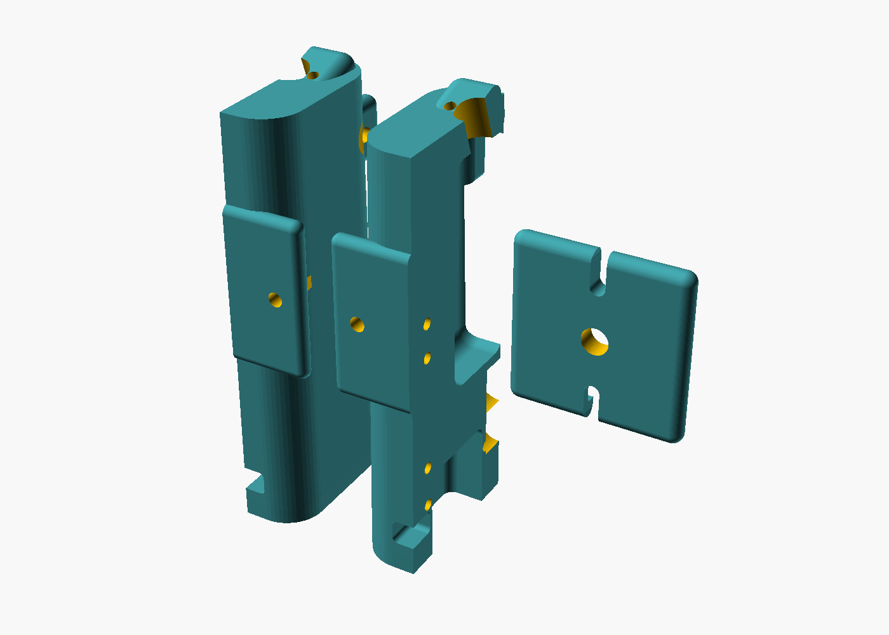

# Vive scope prop — Mk1

A printable flexible-bronchoscope handle with a spring-centred deflection lever
and a quick-release Vive Tracker mount. It exists because the evidence says the
physical scope interface is what gives commercial trainers their fidelity
(docs/08), and because a wand trackpad is a poor substitute for a thumb lever.

**What it senses**

| Axis | Sensor | Maps to |
| --- | --- | --- |
| Deflection lever | AS5600 magnetic encoder (12-bit, non-contact) | `lever` in `Endoscope.advance()`, −1 … +1 |
| Shaft torque | Vive Tracker 6-DoF pose | `roll_deg` (rotation about the handle's long axis) |
| Hand position | Vive Tracker 6-DoF pose | hand anchor / clutch reference |
| Insertion | **not** on the prop in Mk1 | clutch + scaled hand motion, or the wand in the other hand |

Mk1 deliberately has no buttons: it is a passive prop plus one real instrument
axis. Buttons, a working-channel trigger and a linear rail are Mk2.



## Parts

| File | Qty | Notes |
| --- | --- | --- |
| `stl/handles__handle_right.stl` | 1 | carries the insert threading and the alignment pins |
| `stl/handles__handle_left.stl` | 1 | carries the AS5600 mounting plate |
| `stl/levers__lever.stl` | 1 | pivots on an M4 bolt, magnet in the hub |
| `stl/shoe__tracker_shoe.stl` | 1 | bolts to the Tracker, then slides onto the pad |
| `stl/collar__shaft_collar.stl` | 1 | clamps a 10 mm tube as a dummy shaft |
| `stl/cradle__scope_cradle.stl` | 0–1 | optional: holds a real bronchoscope instead |

Both halves are exported **split-face down**, so they print without supports and
every screw bore comes out vertical.

## Bill of materials

| Item | Spec | Qty | Notes |
| --- | --- | --- | --- |
| M3 heat-set inserts | Ø4.6 × 6 mm | 4 | into the right half |
| M3 × 12 socket head | | 4 | clamp the halves |
| M4 × 25 bolt + nyloc nut | | 1 | lever pivot; the nut must be the low-profile kind or recessed |
| O-rings | 18 mm ID, 2.5 mm cord | 2 | lever return; silicone bands also work |
| | or 0.8 mm music wire torsion spring | 1 | upgrade, feels closer to a real scope |
| AS5600 encoder module | GY-AS5600 or similar | 1 | 21 × 16 mm board, I²C |
| Diametric magnet | Ø6 × 2.5 mm | 1 | **diametric**, not axial — the field must cross the gap |
| RP2040 board | Pico or RP2040-Zero | 1 | USB-C preferred |
| Wire | 30 AWG silicone, 4 cores | 150 mm | SDA/SCL/3V3/GND |
| M2 × 6 self-tapping | | 2 | AS5600 board to its plate |
| 1/4-20 × 20 bolt | | 1 | Tracker to shoe |
| Silicone tube | 10 mm OD, 400 mm | 1 | optional dummy shaft |
| PETG | ~180 g | | PLA works for a first fit check but creeps |

Approximate cost excluding the Tracker: **€25–35**.

## Print settings

| Part | Orientation | Layer | Walls | Infill | Supports |
| --- | --- | --- | --- | --- | --- |
| handle_left / handle_right | as exported (flat face down) | 0.2 mm | 4 | 20 % gyroid | none |
| lever | flat on its side face | 0.16 mm | 5 | 40 % | none |
| tracker_shoe | flat | 0.2 mm | 4 | 25 % | none |
| shaft_collar | upright | 0.16 mm | 4 | 50 % | none |
| scope_cradle | as exported | 0.2 mm | 4 | 15 % | none |

PETG at 240 °C / 80 °C bed. The halves are 126 mm tall and print in ~4–5 h each
on a 0.4 mm nozzle. **Dry the PETG** — the grip is a large solid and wet
filament will string inside the bay.

Insert the heat-set inserts while the right half is still warm from the printer
or with a soldering iron at 220 °C, pressing straight down into the four bores
at the split face.

## Assembly

1. **Magnet into the lever.** Press the Ø6 × 2.5 diametric magnet into the hub
   pocket on the flat side, flush or 0.2 mm proud. Check polarity later, not now.
2. **AS5600 onto the left half.** Screw the board to the small plate inside the
   thumb recess with two M2 self-tappers. The chip must face the hub, air gap
   1.5–3 mm.
3. **Wire the encoder** (see pin table below) and route the four wires back
   through the wire channel into the bay.
4. **Lever into the right half.** Push the M4 bolt through the ear, lever hub,
   second ear. Fit the nyloc nut, tighten until the lever moves with slight
   drag and no wobble.
5. **O-rings.** Hook one O-ring between the lever's side post and the right
   half's spring seat, the other to the left half's seat. Both halves need to be
   present before the lever is spring-centred.
6. **Dry-fit the halves.** Check the split closes with no gap and the lever
   swings to both stops without touching the recess walls.
7. **Electronics into the bay.** RP2040 in the bay, USB-C aligned with the rear
   tunnel. Flash the firmware (`firmware/prop_controller/`) before closing.
8. **Close the clamshell.** Four M3 × 12 through the left half into the inserts,
   alternating corners. Do not over-tighten; the printed posts will strip before
   the insert does.
9. **Tracker shoe.** Bolt the 1/4-20 × 20 through the shoe into the Tracker. Slide
   the shoe's keyholes over the two M3 screw heads on the back pad and push down
   to seat it. The screw heads act as a dovetail.
10. **Shaft collar** (optional). Slip the 10 mm tube through the collar, clamp
    with the M3 pinch screw, then fix the collar to the top-front land with two
    M3 × 10. A real bronchoscope can be strapped into `scope_cradle` instead.

## Wiring

| AS5600 | RP2040 |
| --- | --- |
| VCC | 3V3 |
| GND | GND |
| SDA | GP4 |
| SCL | GP5 |
| DIR | GND (swap to 3V3 to invert the axis) |

The encoder is read over I²C at 0x36; the firmware reports a HID joystick axis,
so nothing else is needed on the Linux side. Verify with:

```bash
jstest /dev/input/js0          # watch axis 0 while moving the lever
```

## Calibration

1. Power the prop over USB.
2. On first boot the firmware prints `CALIBRATION: sweep the lever to both stops
   (8 s)` on the serial port (115200 baud).
3. Sweep the lever fully both ways until it prints `calibration saved`.
4. Re-calibrate at any time by erasing flash: hold the lever fully forward while
   resetting, or send `#` … see the firmware's `start_calibration()`.

The firmware applies a ±3 % deadzone around centre and clamps to the calibrated
span, so the simulator receives a clean −1 … +1.

## Using it in the simulator

1. `jstest` shows the axis moving; note the device number.
2. In Godot, map the axis to the `scope_deflect` action, or feed it straight into
   `Endoscope.advance(insert_mm, lever, roll_deg, dt)` through the input adapter
   (M1 work). `src/scope/lever_mapper.gd` handles deadzone, inversion and clamp.
3. Mount the Tracker on the shoe and use its pose for `roll_deg`: measure the
   handle's long axis in Tracker space once, then the difference between the
   current and reference rotation about that axis is the torque input.

## Known limitations (Mk1)

- **Insertion is not instrumented.** There is no rail or encoder; the clutch +
  scaled hand motion mapping is a compromise until Mk2.
- **No buttons.** Suction, tool and clutch come from the other hand's wand or the
  keyboard.
- **Throw is ±22°.** Real scopes give ±70° at the lever; a longer throw needs a
  deeper recess and a bigger grip.
- **One spring pair** means the lever return is slightly progressive. Swap to a
  torsion spring if it bothers you.
- **The Tracker must see the base stations.** Mounting it on the back pad keeps
  it clear of the hand but it can be occluded when you turn away; add a second
  Tracker or reposition the base stations if tracking drops.
- **Not a medical device.** It is a training prop; the magnet is small, so keep
  it away from implants if that is a concern for your users.

## Mk2 candidates

- Index-finger clutch button and a thumb suction button (two 6 mm tactile
  switches, wires through the existing bay).
- A linear rail or sprung sheath so insertion is measured directly.
- Magnetic-particle-brake lever for real force feedback.
- Interchangeable lever cams to match different scope models.

## Licence

MIT, like the rest of the repository. Print it, modify it, sell it — just do not
claim it is validated.
